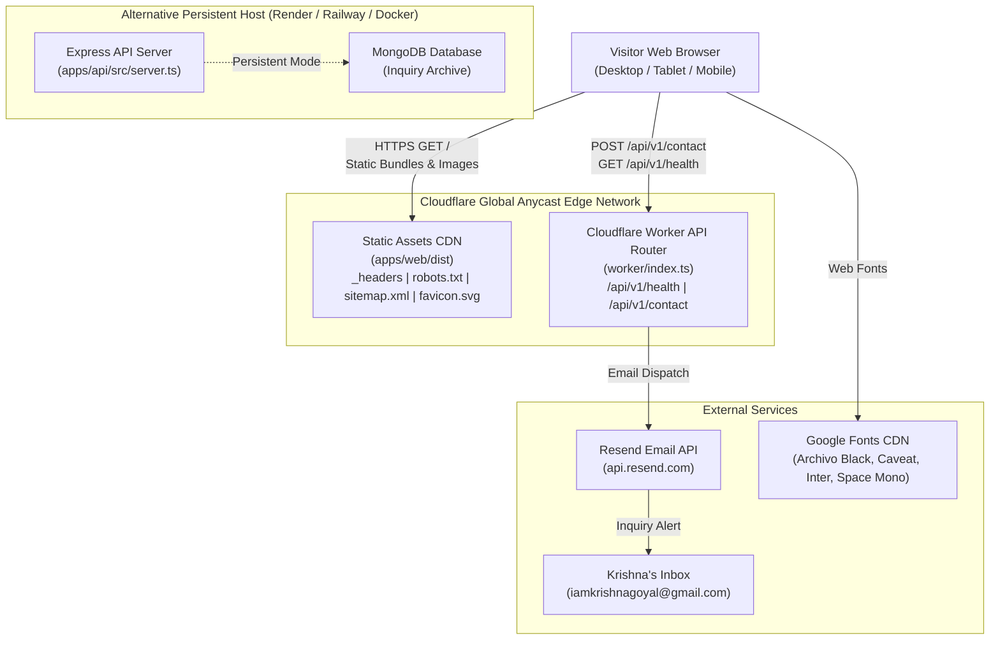
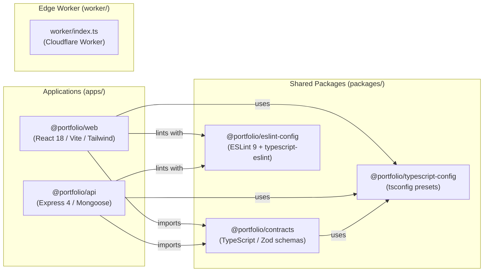

# System Architecture & Technical Design

**Project:** Error Krishna Portfolio & Engineering Showcase  
**Live Production URL:** [https://errorkrishna.com](https://errorkrishna.com)  
**Author:** Krishna Goyal ([@Error-Krishna](https://github.com/Error-Krishna))  
**Repository Pattern:** Turborepo pnpm Monorepo

---

## 1. High-Level System Topology

---

## 2. Monorepo Package Relationships

The workspace is managed using **pnpm workspaces** and **Turborepo** with strict unidirectional dependencies:

---

## 3. Frontend Architecture (`apps/web`)

### 3.1 Routing & Route Boundaries

The application uses **React Router 7.2** with data router APIs (`createBrowserRouter`):

- `/`: Primary single-page portfolio experience (`HomePage`).
- `/work/:slug`: Deep-dive project case study view (`ProjectDetailPage`).
- `/project/:slug`: Canonical alias for project case studies.
- `/resume`: Dedicated interactive resume view with downloadable PDF (`ResumePage`).
- `*`: Custom interactive 404 page with animated compass and return CTA (`NotFoundPage`).

### 3.2 State Management & Theme Context

- **ThemeContext:** Manages persistent `'light' | 'dark'` modes. The state is synchronized synchronously before React render in `index.html` to eliminate dark mode flashing (FOUC), and updated reactively via `document.documentElement.classList`.
- **Navigation State:** `CornerNavigationDial` maintains separate states for the actual active section (computed from scroll position via IntersectionObserver) and the previewed section (scrubbed via wheel or touch).

### 3.3 Interactive UI Systems

1. **Dynamic Island:** Global identity capsule floating at top-center. It features a pulsing availability beacon, local Indian Standard Time, and an animated tray expanding into verified social profiles.
2. **Corner Navigation Dial:** Quarter-circle arc dial pinned to bottom-right. Supports direct click, mouse wheel scrubbing, and touch gestures to jump between 7 sections (`hero`, `about`, `projects`, `services`, `how-it-works`, `skills`, `contact`).
3. **Scroll-Driven Dual Portrait Transition:** Coordinated CSS transforms and scroll listener that fluidly transition Krishna's portrait between the Hero heading and the About section bio.
4. **3D Flip Card System:** CSS perspective cards that flip 180 degrees along the Y-axis on hover (desktop) or touch button toggle (mobile), revealing project metadata and key deliverables.

---

## 4. Backend & Edge Routing Architecture

### 4.1 Production Edge Router (`worker/index.ts`)

The production router runs as an edge-native Cloudflare Worker:

- **Zero-SDK Fetch:** Calls `https://api.resend.com/emails` directly with HTTP `POST` and authorization headers.
- **Input Sanitization:** Uses `escapeHtml()` to mitigate HTML injection risks in forwarded email bodies.
- **Envelope Compliance:** Emits standardized response envelopes `{ success: true, data: ... }` or `{ success: false, error: { code, message } }`.
- **Static Asset Fallback:** Non-API requests fall through to `env.ASSETS.fetch(request)`.

### 4.2 Alternative Express API (`apps/api`)

Provides an enterprise Node.js alternative for environments requiring persistent database connections:

- **Middleware Chain:** `helmet` → `cors` → `requestIdMiddleware` → `express.json` → `requestLogger` → `rateLimit` → routes → `notFound` → `errorHandler`.
- **Resilience:** If MongoDB is unavailable, the API starts gracefully in non-persisted mode, allowing health checks and email dispatch to continue operating.

---

## 5. Security & Data Protection Design

1. **Security Headers:** Enforced via `apps/web/public/_headers` on Cloudflare CDN and in Express via `helmet`:
   - `X-Content-Type-Options: nosniff`
   - `X-Frame-Options: SAMEORIGIN`
   - `Referrer-Policy: strict-origin-when-cross-origin`
   - `Permissions-Policy: camera=(), microphone=(), geolocation=()`
2. **External Link Safety:** All user-facing outbound links enforce `target="_blank"` and `rel="noopener noreferrer"`.
3. **Sanitization:** String fields in contact submissions are trimmed, length-validated, and HTML-escaped before email composition.
4. **Secrets Segregation:** Secrets (`RESEND_API_KEY`) are managed via Cloudflare Worker secrets and `.env` files explicitly excluded from git.
