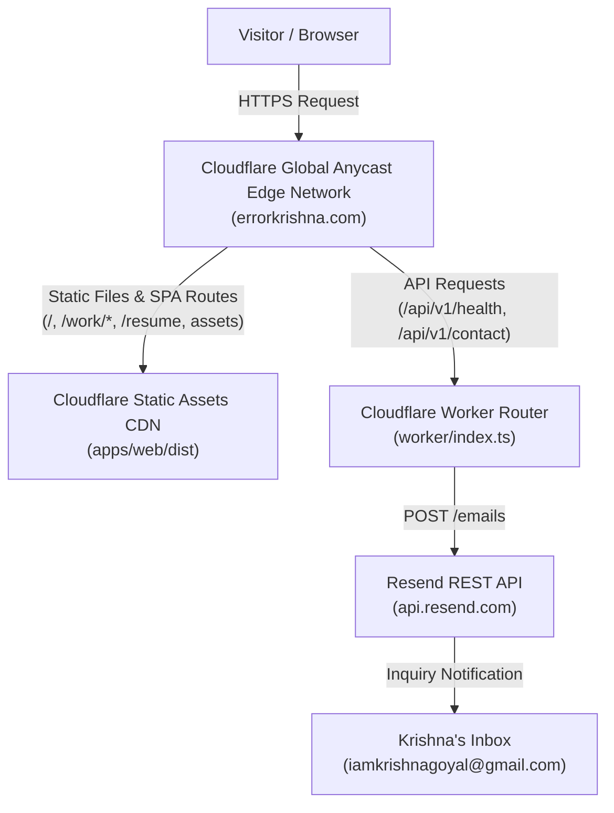

# Production Deployment Guide: Cloudflare Workers & Multi-Platform Architecture

**Target Platform (Active Production):** Cloudflare Workers with Static Assets  
**Live Production Website:** [https://errorkrishna.com](https://errorkrishna.com)  
**Alternative Redirection:** [https://www.errorkrishna.com](https://www.errorkrishna.com) (HTTP 301 redirect to apex)  
**Domain Registrar:** Hostinger  
**DNS & CDN Provider:** Cloudflare  
**Repository Architecture:** Turborepo pnpm Monorepo  
**Packages:** `@portfolio/web` (React/Vite), `@portfolio/api` (Express), `@portfolio/contracts` (TypeScript/Zod), `worker` (Cloudflare Worker)  
**Status:** **ACTIVE IN PRODUCTION**

---

## A. Active Production Architecture: Cloudflare Workers with Static Assets

The primary production deployment runs on **Cloudflare Workers with Static Assets** (configured via `wrangler.jsonc`).



### Key Architectural Characteristics

1. **Edge Static Serving:** Vite compiles the frontend into `apps/web/dist`. Cloudflare serves HTML, CSS, JavaScript, WebP/PNG images, and PDF assets directly from hundreds of global edge data centers.
2. **Single-Page Application Routing:** Cloudflare Asset configuration uses `"not_found_handling": "single-page-application"` so routes like `/work/:slug` and `/resume` hydrate seamlessly without 404s.
3. **Worker-First API Routing:** `wrangler.jsonc` specifies `"run_worker_first": ["/api/*"]`. Requests to `/api/v1/health` and `/api/v1/contact` are routed directly to `worker/index.ts`.
4. **Serverless Email Dispatch:** `worker/index.ts` processes contact form inquiries, validates required fields, formats HTML and plain-text emails, and dispatches them via the Resend API using standard Web `fetch` (zero heavy SDK dependencies).
5. **Edge Security & Cache Rules:** `apps/web/public/_headers` injects strict security headers (`X-Content-Type-Options: nosniff`, `X-Frame-Options: SAMEORIGIN`, `Referrer-Policy: strict-origin-when-cross-origin`) and enables immutable caching for hashed assets (`/assets/*`).

---

## B. Cloudflare Worker Configuration (`wrangler.jsonc`)

The production configuration is declared in `wrangler.jsonc`:

```jsonc
{
  "$schema": "node_modules/wrangler/config-schema.json",
  "name": "errorkrishna",
  "main": "./worker/index.ts",
  "compatibility_date": "2024-11-01",
  "compatibility_flags": ["nodejs_compat"],
  "vars": {
    "CONTACT_EMAIL_TO": "iamkrishnagoyal@gmail.com",
    "CONTACT_EMAIL_FROM": "Krishna Goyal Portfolio <onboarding@resend.dev>",
  },
  "assets": {
    "directory": "./apps/web/dist",
    "binding": "ASSETS",
    "not_found_handling": "single-page-application",
    "html_handling": "auto-trailing-slash",
    "run_worker_first": ["/api/*"],
  },
}
```

### Environment Secrets & Variables

| Variable / Secret    | Type     | Storage                   | Purpose                                                            |
| :------------------- | :------- | :------------------------ | :----------------------------------------------------------------- |
| `RESEND_API_KEY`     | Secret   | Cloudflare Worker Secrets | API key for authenticating with Resend to send contact emails.     |
| `CONTACT_EMAIL_TO`   | Variable | `wrangler.jsonc`          | Recipient inbox address (`iamkrishnagoyal@gmail.com`).             |
| `CONTACT_EMAIL_FROM` | Variable | `wrangler.jsonc`          | Sender header (`Krishna Goyal Portfolio <onboarding@resend.dev>`). |

To set or update the secret in production:

```bash
npx wrangler secret put RESEND_API_KEY
```

---

## C. Domain, DNS & SSL Configuration

1. **Domain Registrar:** Hostinger (nameservers delegated to Cloudflare).
2. **Cloudflare DNS Records:**
   - Apex domain `errorkrishna.com` routed to the Cloudflare Worker with Static Assets.
   - Subdomain `www.errorkrishna.com` configured to 301 redirect to `https://errorkrishna.com/`.
3. **Recommended Cloudflare Dashboard Hardening:**
   - **Always Use HTTPS:** Navigate to **SSL/TLS > Edge Certificates** and toggle **Always Use HTTPS** to **ON**. This ensures plain HTTP requests to `http://errorkrishna.com` immediately upgrade to HTTPS.
   - **Redirect Rule:** Verify that the `www` to apex redirect rule handles both HTTP and HTTPS requests so requests to `http://www.errorkrishna.com` redirect without attempting an origin connection.

---

## D. Deployment Runbook

### Deploying to Cloudflare Workers (Production)

```bash
# 1. Clean previous build artifacts
pnpm run clean

# 2. Run quality checks
pnpm run lint
pnpm run typecheck
pnpm test

# 3. Build contracts and web distribution bundle
pnpm run build

# 4. Deploy worker and static assets to Cloudflare
npx wrangler deploy
```

### Rollback Procedure

If a deployment needs to be reverted:

1. In Cloudflare Dashboard, navigate to **Compute (Workers) > errorkrishna > Deployments**.
2. Select the previously verified deployment and click **Rollback**.
3. Or redeploy a previous Git commit locally:
   ```bash
   git checkout <verified-commit-sha>
   pnpm install
   pnpm run build
   npx wrangler deploy
   ```

---

## E. Supported Alternative Architectures

### Option B: Unified Single Vercel Project

- **Frontend:** Built by Vite into `apps/web/dist`.
- **Backend API:** Adapted via `api/index.ts` to run as a Node.js Serverless Function handling `/api/v1/*`.
- **Config:** `vercel.json` rewrites `/api/(.*)` to `/api/index` and `/(.*)` to `/index.html`.

### Option C: Decoupled Container (Render / Railway / VPS / Docker)

- **Frontend:** Hosted on Cloudflare or Vercel.
- **Backend API:** Persistent Node.js service running `apps/api/src/server.ts` connected to MongoDB Atlas.
- **Docker:** `docker/api/Dockerfile` and `infra/docker-compose.yml` are provided in the repository.
