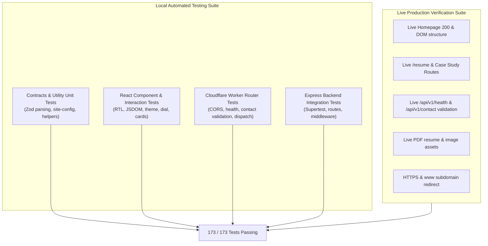

# Testing Documentation & Quality Assurance Strategy

**Project:** Error Krishna Portfolio & Engineering Showcase  
**Live Production URL:** [https://errorkrishna.com](https://errorkrishna.com)  
**Total Automated Tests:** 173 passing (0 failing, 0 skipped)  
**Test Runners:** Vitest 3.2, @testing-library/react 16.2, jsdom 26.0, v8 coverage

---

## 1. Testing Philosophy & Verification Matrix

The portfolio implements a multi-tier testing strategy to ensure production readiness across client-side UI, contract schemas, edge serverless routers, persistent APIs, and live production endpoints.



---

## 2. Test Suites & Directory Structure

```
krishna_portfolio/
├── packages/contracts/src/
│   └── contracts.test.ts          # Zod schema validation & DTO parsing (8 tests)
│
├── apps/api/src/
│   ├── config/env.test.ts         # Environment configuration validation (3 tests)
│   └── modules/
│       ├── contact/contact.test.ts # Express contact endpoint & dispatch mocks (4 tests)
│       └── health/health.test.ts   # Express health check routes (2 tests)
│
├── apps/web/tests/
│   ├── unit/                      # Component unit tests (77 tests)
│   │   ├── AboutSection.test.tsx
│   │   ├── CornerNavigationDial.test.tsx
│   │   ├── DynamicIsland.test.tsx
│   │   ├── HandwrittenAnnotations.test.tsx
│   │   ├── NewSections.test.tsx
│   │   ├── ProjectDetailPage.test.tsx
│   │   ├── ProjectsSection.test.tsx
│   │   ├── ScrollPortraitTransition.test.tsx
│   │   ├── ServicesSection.test.tsx
│   │   ├── siteConfig.test.ts
│   │   ├── TestimonialsSection.test.tsx
│   │   ├── ThemeToggle.test.tsx
│   │   └── withProjectStatus.test.tsx
│   └── e2e/                       # Simulated user and interaction tests (53 tests)
│       ├── click-interactions.test.tsx
│       ├── mobile-e2e.test.tsx
│       └── smoke.test.ts
│
├── worker/
│   └── worker.test.ts             # Cloudflare Worker router & Resend dispatch (9 tests)
│
└── tests/e2e/
    └── portfolio.spec.ts          # Root E2E & Live Production Verification (17 tests)
```

---

## 3. Test Execution Commands

### Run Workspace Package Tests (Contracts, API, Web)

```bash
# Execute unit and component tests via Turborepo
pnpm test
# or
pnpm run test:unit
```

### Run Root E2E and Live Production Verification Tests

```bash
# Runs tests in tests/e2e and worker/worker.test.ts
pnpm run test:e2e
```

### Run Coverage Reports

```bash
# Generate v8 test coverage report
pnpm run test:coverage
```

### Targeted Package Testing

```bash
# Test contracts only
pnpm --filter @portfolio/contracts test

# Test frontend only
pnpm --filter @portfolio/web test

# Test backend API only
pnpm --filter @portfolio/api test
```

---

## 4. Test Categories Breakdown

| Category            | Suite / Location                           |  Tests  |  Status  | Scope                                                                                                                              |
| :------------------ | :----------------------------------------- | :-----: | :------: | :--------------------------------------------------------------------------------------------------------------------------------- |
| **Contracts**       | `packages/contracts/src/contracts.test.ts` |    8    | ✅ PASS  | Validates Zod schema parsing, required fields, error messages, and response envelope typing.                                       |
| **API**             | `apps/api/src/**/*.test.ts`                |    9    | ✅ PASS  | Verifies Express routes, health endpoints, environment variable loading, and mock email dispatch.                                  |
| **Component**       | `apps/web/tests/unit/*.test.tsx`           |   77    | ✅ PASS  | Verifies UI components render correctly, props pass as expected, dark mode toggles, and dials function.                            |
| **Interactive E2E** | `apps/web/tests/e2e/*.test.tsx`            |   53    | ✅ PASS  | Simulates real user clicks across full viewports, verifies touch targets, mobile responsiveness, and anchor scrolls.               |
| **Worker**          | `worker/worker.test.ts`                    |    9    | ✅ PASS  | Validates Cloudflare Worker routing, CORS preflight, Resend API integration, and static asset pass-through.                        |
| **Production**      | `tests/e2e/portfolio.spec.ts`              |   17    | ✅ PASS  | Direct network tests against `https://errorkrishna.com`, verifying 200 statuses, health check, PDF download, and image MIME types. |
| **Total**           |                                            | **173** | **100%** | Comprehensive full-stack verification.                                                                                             |

---

## 5. Live Production Verification Details

The automated suite in `tests/e2e/portfolio.spec.ts` runs directly against `https://errorkrishna.com`:

1. **Homepage:** Confirms HTTP 200, HTML content type, preconnected Google Fonts, and `#root` element.
2. **Case Studies:** Confirms HTTP 200 and successful SPA rendering for `/work/udhyog-saathi`, `/work/insightloop`, `/work/lucid`.
3. **Resume Route:** Confirms HTTP 200 and HTML envelope on `/resume`.
4. **Health Endpoint:** Confirms `/api/v1/health` returns `status: "ok"`, `environment: "production"`, and `version: "1.0.0"`.
5. **Contact Endpoint Validation:** Verifies empty payload returns HTTP 400 with `VALIDATION_ERROR` and malformed JSON returns HTTP 400 with `INVALID_JSON`.
6. **Resume PDF Asset:** Confirms `/resume/krishna-goyal-resume.pdf` returns HTTP 200 with `application/pdf`.
7. **Production Imagery:** Confirms all hero and portrait images return HTTP 200 with appropriate MIME types (`image/png`, `image/jpeg`).
8. **Subdomain Redirection:** Confirms `https://www.errorkrishna.com` returns HTTP 301 redirecting to `https://errorkrishna.com/`.
